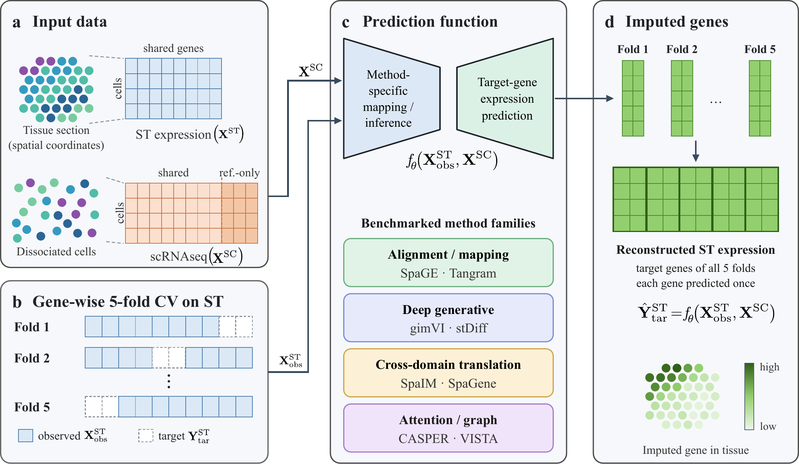

# Assessing Predictive Reliability and Biological Consistency of Gene Imputation Methods in Spatial Transcriptomics

> Code and evaluation workflow accompanying **[Assessing Predictive Reliability and Biological Consistency of Gene Imputation Methods in Spatial Transcriptomics]**.

<!-- 
 -->

## Overview

Spatial transcriptomics (ST) preserves tissue organization but often measures fewer genes than single-cell RNA sequencing (scRNA-seq). Gene expression imputation methods aim to infer unmeasured genes in spatially resolved cells or spots using complementary scRNA-seq data.

This repository accompanies a systematic benchmark of gene expression imputation across diverse ST technologies and biological settings. Beyond gene-wise reconstruction accuracy, the study examines cellular organization and recovery of biologically relevant gene programs.

## Benchmark scope

### Datasets

| Dataset | Tissue/context | Spatial technology |
| --- | --- | --- |
| seqFISH (Allen VISp) | Mouse visual cortex | seqFISH |
| STARmap (Allen VISp) | Mouse visual cortex | STARmap |
| UC1_NI | Human ulcerative colitis | Xenium |
| BC_data | Human breast cancer | Xenium |
| lungsCAN | Human lung cancer | Xenium |

The spatial datasets are paired with corresponding scRNA-seq reference data. See the paper and dataset documentation for accessions, matching criteria, and preprocessing details.

### Methods

The main comparison covers **gimVI, SpaGE, Tangram, stDiff, SpaIM, SpaGene, VISTA, and CASPER**. Additional methods are reported in the supplementary analysis where applicable.

### Evaluation

- **Gene-level reconstruction:** Pearson correlation coefficient (PCC), Spearman rank correlation coefficient (SRCC), gene-wise mean absolute percentage error (MAPE), and Kullback–Leibler (KL) divergence.
- **Cellular organization:** Adjusted Rand index (ARI), adjusted mutual information (AMI), homogeneity, and normalized mutual information (NMI).
- **Biological relevance:** Gene-wise recovery in biologically relevant pathways and gene-set analyses.
- **Highly variable genes:** Performance across subsets of highly variable genes (HVGs).

## Experimental design

1. Load spatial and matched scRNA-seq data.
2. Harmonize gene identifiers and identify the shared gene set.
3. Apply the preprocessing specified in the paper.
4. Split spatially measured genes into five folds; train or fit methods using observed genes and evaluate predictions on held-out genes.
5. Compute metrics on held-out genes and aggregate across folds as mean ± standard deviation.
6. Perform cellular organization, HVG, and pathway-level analyses.

